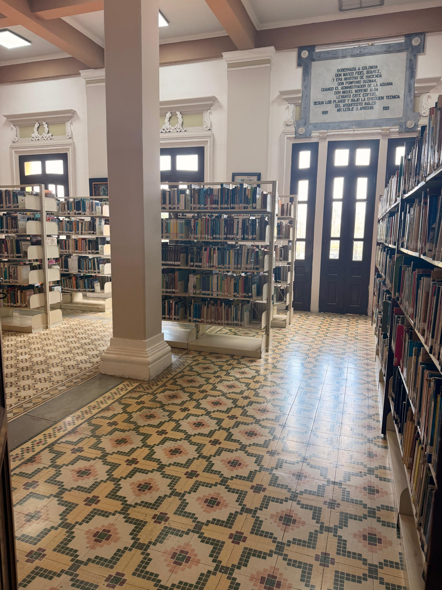
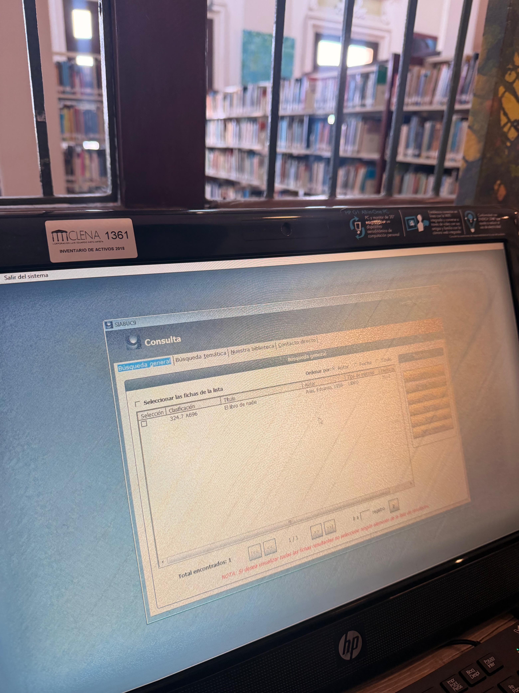
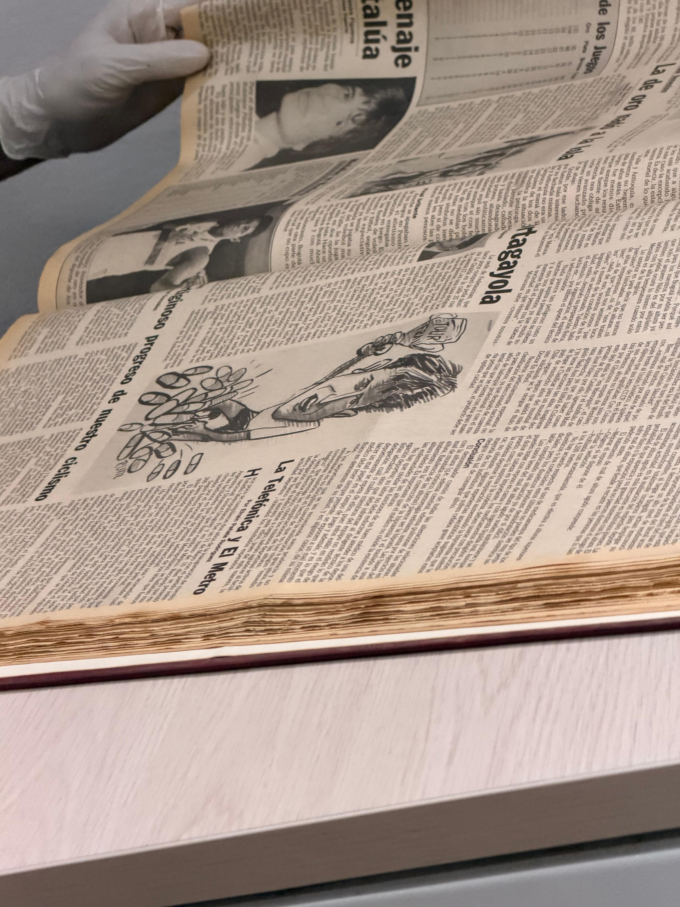

# Personas · P2 Consulta Fácil

Cuatro tipos de usuario basados en lo que observamos en la visita del 26 de septiembre de 2026 a la Biblioteca del CLENA. Los nombres, edades y detalles son **ficticios**. Las fotos no muestran rostros de visitantes.

## Lo que vimos en la visita

| Evidencia | Qué muestra |
|---|---|
|  | Estanterías de la Biblioteca con muchos libros y sin una señal visible que indique qué hay en cada una. Hay que recorrer los pasillos para ubicar un título. |
|  | Pantalla del software de consulta (SIABUC9). El resultado de «Búsqueda general» muestra un código de clasificación, el título, el autor, el año y el tipo de material, pero no dice en qué sala, sección o estante está. El texto es pequeño y el contraste es bajo. |
|  | Periódico encuadernado en el Archivo Histórico, manipulado con guantes. No es la Biblioteca; sirve para entender cómo es la consulta de un investigador. |

## Persona 1 · Doña Carmen, 70 años (visitante lectora)

| | |
|---|---|
| **Qué hace en el CLENA** | Va a la Biblioteca a leer novelas y a pedir libros que recuerda a medias. |
| **Comodidad con la tecnología** | Baja. Usa el celular solo para llamar y para WhatsApp. |
| **Qué le frustra hoy** | No entiende el buscador actual y le da pena pedir ayuda cada vez. No sabe a qué estante ir cuando encuentra el título. |
| **Qué necesita lograr** | Escribir una parte del título, ver el resultado y saber a qué sala y estante ir, con letra grande. |
| **Historias** | HU-01, HU-03, HU-04, HU-15 |

## Persona 2 · Andrés, 20 años (estudiante universitario)

| | |
|---|---|
| **Qué hace en el CLENA** | Busca fuentes para trabajos de la universidad. |
| **Comodidad con la tecnología** | Alta. Prefiere usar su celular. |
| **Qué le frustra hoy** | El sistema exige términos exactos y muestra códigos de clasificación en vez de ubicaciones. No sabe si el libro está prestado. |
| **Qué necesita lograr** | Buscar por tema o autor desde el celular, escaneando un QR, y ver si el libro está disponible. |
| **Historias** | HU-02, HU-05, HU-06, HU-08, HU-13 |

## Persona 3 · Luisa, 42 años (investigadora de historia local)

| | |
|---|---|
| **Qué hace en el CLENA** | Consulta libros y documentos del Archivo Histórico para una investigación sobre la ciudad. |
| **Comodidad con la tecnología** | Media. |
| **Qué le frustra hoy** | No sabe si un documento tiene versión digital o está prestado, y pierde viajes. |
| **Qué necesita lograr** | Filtrar por tema y disponibilidad, y ver si hay versión digital. |
| **Historias** | HU-06, HU-08, HU-14, HU-21 |

## Persona 4 · Marta, 35 años (bibliotecaria del CLENA)

| | |
|---|---|
| **Qué hace en el CLENA** | Atiende a los visitantes, los orienta en el uso del software y lleva los préstamos. |
| **Comodidad con la tecnología** | Media. |
| **Qué le frustra hoy** | Repite la misma explicación a cada persona nueva y hace las búsquedas por quien no logra usar el sistema. |
| **Qué necesita lograr** | Mantener el catálogo y los préstamos al día sin duplicar trabajo, y que el visitante consulte solo. |
| **Historias** | HU-09, HU-10, HU-11, HU-12, HU-18, HU-19, HU-20 |

## Nota

Estas personas parten de la visita y del borrador de `docs/backlog.md` del repositorio de Backend. Si la validación con el personal del CLENA aporta cambios, se ajustarán.
